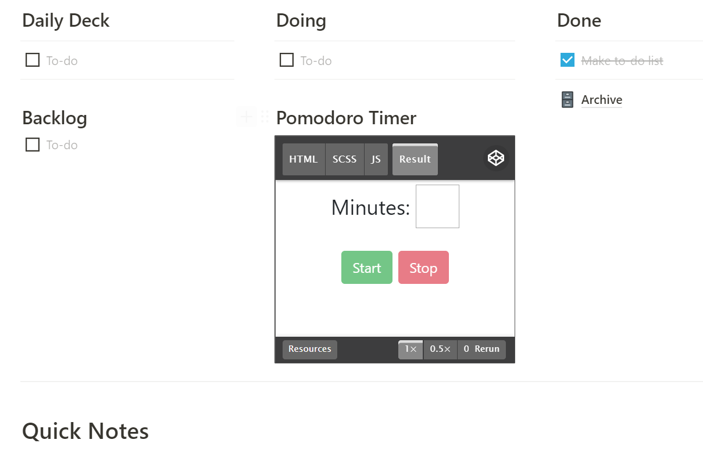
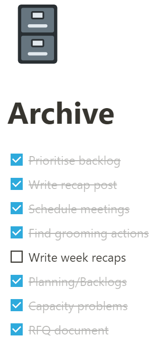

As I mentioned in my last post, I have been uncomfortably busy these last weeks/months, and so have pulled back on lower-priority activities like this blog. Winter break is coming soon, and along with it a few weeks of rest :)

When I'm too busy to rely on my memory alone - which, let's be real, is most of the time - I go to my To-Do lists. I've used *everything* over the years, from arrays of Post-It notes to well-manicured Trello boards. I've finally settled on a simple system using [**Notion**](https://www.notion.so/product).

This little structure here has served me dependably over the past year-or-so, and I expect to continue using it well into the future:

In the following paragraphs, I'll describe how I make use of each section.

## Daily Deck

My "pull stack". At the beginning of my day I try to have a deck of tasks that I expect I could clear through in the course of the day. I also do a quick prioritisation - Notion is great for this with its easy drag-and-drop. 

I try to make my tasks small enough that I can actually complete them in one go. Most of the time that's possible, sometimes it's not. If a high-priority task pops up during the day, I just add it to the daily deck. It's an art, not a science.

The most important thing for me is I don't end up going off the rails midway through my day because I stopped trusting my tool to give me the highest priority and actionable items. 

## Backlog

The backlog holds the tasks that are lower-priority, not time-sensitive (yet), or for some reason just didn't end up on the daily deck.

This is one of the most important functions of this to-do list: a place I can jot down a future task and get it out of my brain, so I can re-focus on whatever is actually at-hand.

Sometimes I like to prioritise this list. I try to prune it regularly and limit it to 10-15 items. 

I will happily delete items that get "stale" low down on the list, because if they're truly important then they're likely to come back up on this list again later.

## Quick Notes (down at the bottom)

This section was a late addition, but has been a total lifesaver.

All this is, is a scratchpad. If I'm in an important customer meeting or getting feedback from a team member, sometimes I just need a place to jot down notes without losing focus.

I love that my scratchpad sits so closely to my To-Do list. It's often that one will feed into the other, like a task will depend on a note I took the day before, or a note will turn into a To-Do item.

I often let this scratchpad fill up with stray notes. At some point in the week, I will take the time to come through and tidy it up, moving notes to other pages or systems as needed.

## Doing

The 1 task that I'm working on in the moment.
I never bring in more than 1 task, because I know I will fail if I try to commit to more.

The cold truth is that as a mostly-remote project manager who likes to "wear many hats", my time is *always* being used and emails and Slack/Teams notifications drip in constantly. So the more I can keep my own "in progress" tasks limited, the better. 

1 is plenty.  

## Pomodoro Timer

A litle script I slapped together in [Codepen](https://codepen.io). It beeps when the time runs out (the beep always scares the crud out of me!).

I wish I used this more often - I'm using it now for writing this post, but typically in my work day it's hard to block off 20 minutes of uninterruptable time. Maybe this is one of things that's worth challenging, *because it's hard*.

## Done

When I finish a task, I cross it out, then drag it over to the Done pile. It gives me joy to see the pile of finished tasks at the end of my day (or whenever I get to cleaning the Done pile).

Sometimes I move unfinished/unstarted tasks over to the Done pile. This could be if I've delegated the task to someone else. It's nice to know that a task been handled and can exit my head-space.

### Archive

Whenever the Done pile has grown long enough, I select everything in it and drag it into the **Archive**. This means the task disappears from the To-Do list, and can be found again if I click into the Archive:

I don't like deleting tasks. I like having a chronologically-sorted dump of all the tasks I've worked on. I almost never go in here, but it's good for:

1. Searching and auditing, if ever I'm asked when something was done (though usually I'm good at leaving tracks in actual systems of record). Notion has metadata on all of these tasks, so I can see when they were moved into this Archive. That's just useful enough for my purposes.
2. Making me feel good about my progress. This tool isn't going to reward me with candy, but a little dopamine boost doesn't hurt :)

# Try it Out!

If you use Notion, or want to give it a shot, you can make a template of my To-Do list [here](https://www.notion.so/ToDo-d24efa01db8c4cfe93e9b16246a2741d)!

What do you think? Do you use a similar tool? Do you see areas for improvement in this To-Do list, or how I use it? If so please leave a comment!