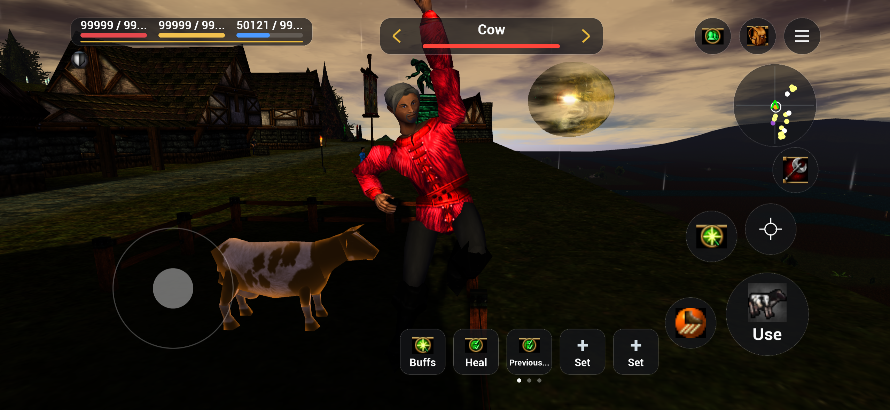
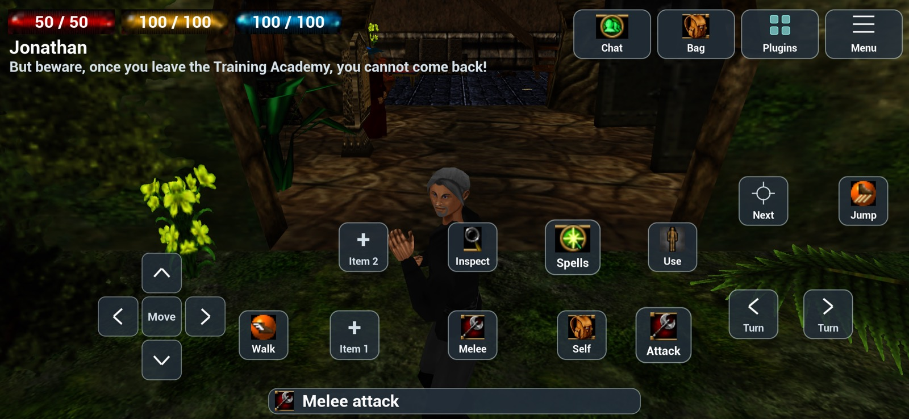
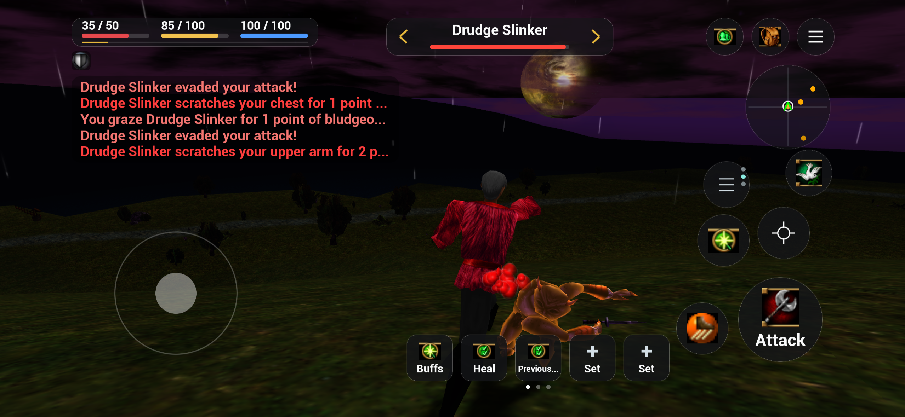
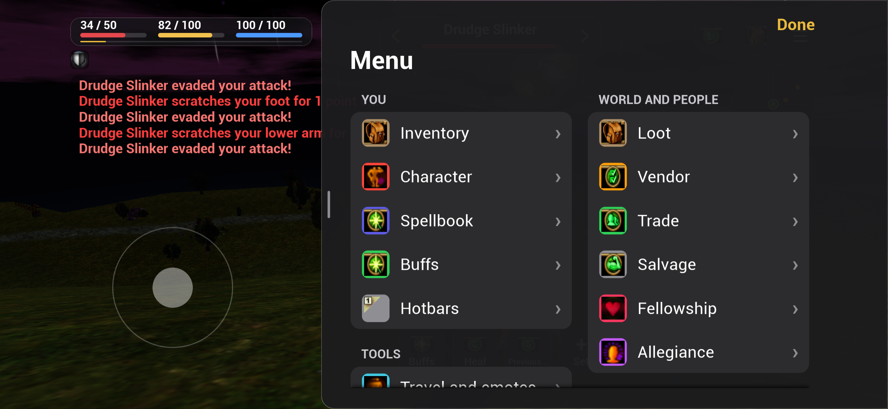
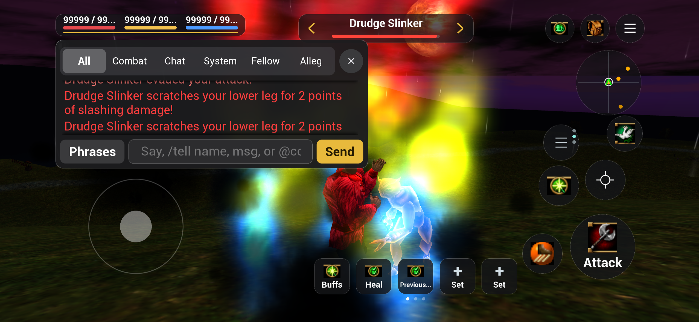
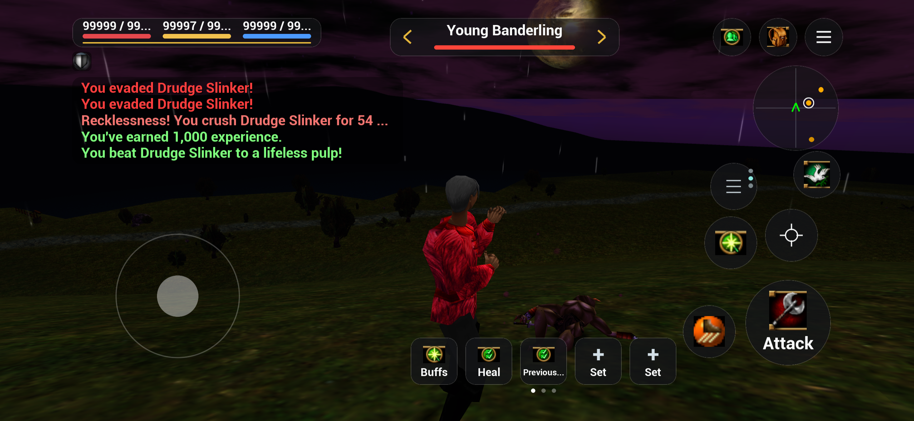
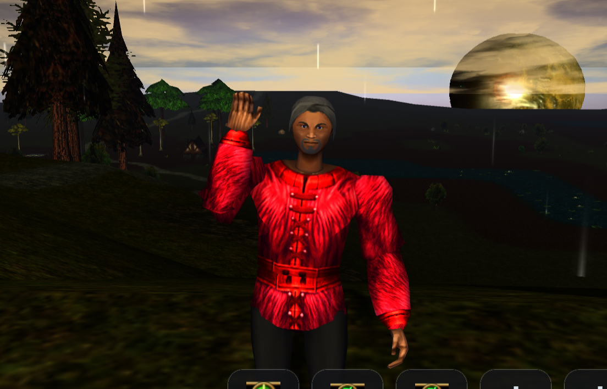

As someone who lives and breathes software, 2026 has been a year where the unimaginable has suddenly become very real, spurred on by step changes in LLM capability. 

In one such case, on a whim and *in a single evening* I managed to get a cherished PC game lost to time up and running on the last place anyone ever meant it to run - my phone!

## The backstory: a lost treasure

Asheron's Call released in 1999 as one of the first 3D MMORPGs, in the same generation as the far more popular EverQuest and Ultima Online. 

AC boasted a few things that hit a sweet spot for me as a young gamer:
- An expansive world to explore ("Dereth"), with a gigantic and impressively seamless overworld map and hundreds of large dungeons to get lost in.
- A wide roster of weird and unique creatures - "Drudges" and "Tumeroks" and "Virindi" instead of stock fantasy elves and goblins.
- A tight-knit community formed around clans that had a reason to socialize. At one point my dad and I even drove to South Carolina to meet our clan in person.
- Monthly updates that advanced a plot where players had an impactful role (on my server, [players fought in round-the-clock shifts to thwart an invasion event](https://asheron.fandom.com/wiki/The_Shard_of_the_Herald#Thistledown_Defense), something the other servers failed - much to the surprise of the devs, who left a monument in the game to the players involved).
- Character development with a flexible progression tree and easy respecs.
- Zero handholding - late 90s PC gaming at its best!

It also boasted some features that I mostly overlooked at the time, like intense player-versus-player combat as an opt-in mechanic.

Asheron's Call had a formative impact on me as a young gamer, and I spent hundreds if not thousands of hours immersed in its world. I have precious memories of playing this game until the wee hours of the morning when I could hear birds chirping outside.

AC started dying out in the 2000s. By the 2010s there were only a handful of people online at a time, and the massive game world suddenly felt empty, outside of a few hubs that were mainly populated by bot vendors.

### The death of a game

Asheron's Call became an early bellwether of a modern industry plague: a game that relied on company-hosted servers, and ownership that changed hands several times over the years. The monthly updates turned into "maintenance mode". Pulling the plug on the game - and the community that held onto it dearly despite the march of time - became a question of when, not if.

After an attempted sequel fizzled out, it was clear that Asheron's Call was on borrowed time. The developers promised an exit strategy of distributing the servers for private hosting, but as months dragged into years, it became clear that this wasn't going to happen.

In 2017, [the plug was pulled on Asheron's Call](https://www.engadget.com/2016-12-21-asherons-call-to-shut-down.html). Even though I wasn't playing any more, it felt like a part of me died with it.



## Jumping back in - round one

In the waning weeks, [players combed the game](https://github.com/ACEmulator/aclog), gathering as much data as possible in captured network traffic between the clients and servers.

The data enabled the community to develop open source server rebuilds. A few implementations came out on top, including the [ACE](https://github.com/acemulator/ace) project. Over Easter break this year, I spun up ACE, got a client running on my Linux PC with some Windows compatibility utilities, and I jumped back into Dereth for an incredible long weekend.

Exploring Dereth was a wonderful delight, with so much nostalgia to soak in, from the death cries of a Drudge Prowler to the awe of familiar places like Holtburg and Glendon Wood where I'd spent so many hours of my childhood. 

As I also hosted the server, I could give myself superpowers, enabling me to hop across levels at lightning speed and experience all of the old hits the game had to offer.

With my character maxed out and my nostalgia overfed, I put the game back down and went back to my busy life.

## Enter Claude

Spurred by a wave of games getting VR remakes, I did some searching and came across a project from the illustrious Thwargle, who is well known in the community for their innovative work to keep the game alive.

Thwargle had managed to [make an AC client in the Unreal Engine](https://www.youtube.com/watch?v=8Yc0Um1f6sk), which enabled [getting AC running in VR](https://thwargle.com/unreal-vr/). From there, it only took a single evening for me - powered by Opus 5.5 - to get a build running on iOS.

The first picture of Asheron's Call on an iPhone (as far as I know - maybe someone else beat me to it!):

Seeing Asheron's Call brought to life on my iPhone of all devices felt as magical and uncanny as the first time I got it running on my PC.

With a bit of finagling, I built in a modern iOS-friendly UI, and have been immersing myself again in the sights and sounds of my beloved game. 

Fighting a dastardly Drudge Slinker - my unleveled, unarmed character not doing so hot:

Breaking out the menu to find the cheats:

Now I'm a GOD!

Drudge meets its maker:

## What it means

2026 is the year AI broke. As a software developer, I fear for the future, where craftsmanship falls by the wayside and production becomes largely AI-driven, with the technology that enables it all in the hands of a couple massive companies with questionable visions for society. I struggle to envision a future that isn't dystopian.

However, there are - for now - astonishing upsides. It took a heroic community effort to bring Asheron's Call back to life, and AI means even more avenues for revisiting classics like it in new ways. I don't imagine new folks will be brought into the game, but for those of us who still treasure it (there are dozens of us!), it is an indescribable feeling to be able to experience it anew, in places previously unimaginable like an iPhone.

So, with great unease about what looms on the horizon, I am content to enjoy a moment of ignorant bliss in my dear world of Dereth. I hope you'll join me :)

